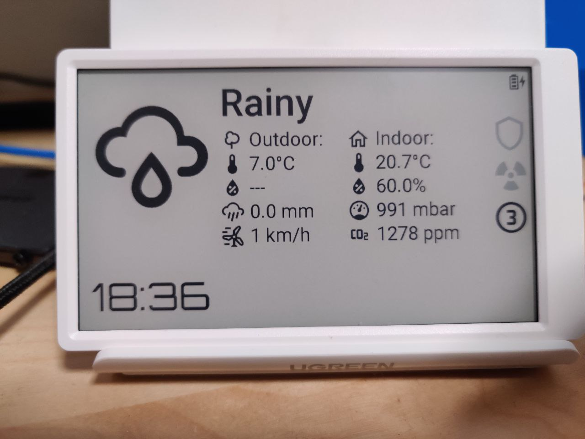

> [!IMPORTANT]
> # :tada: Now officially supported by ESPHome
>
> The M5Paper components from this repository are now included in the **official ESPHome release**.
>
> :arrow_right: **Do not use this repository for new installations.**  
> :arrow_right: **Existing users should migrate to the [components provided directly by ESPHome](https://esphome.io/components/display/it8951/).**
>
> This repository is kept for reference only.

# m5paper_esphome

Based on https://github.com/paveldn/m5paper_esphome

Himself based on https://github.com/sebirdman/m5paper_esphome

Work in progress

All components are functional, but likely have bugs. 

Please, download font from https://materialdesignicons.com/ and put in 'fonts' folder
